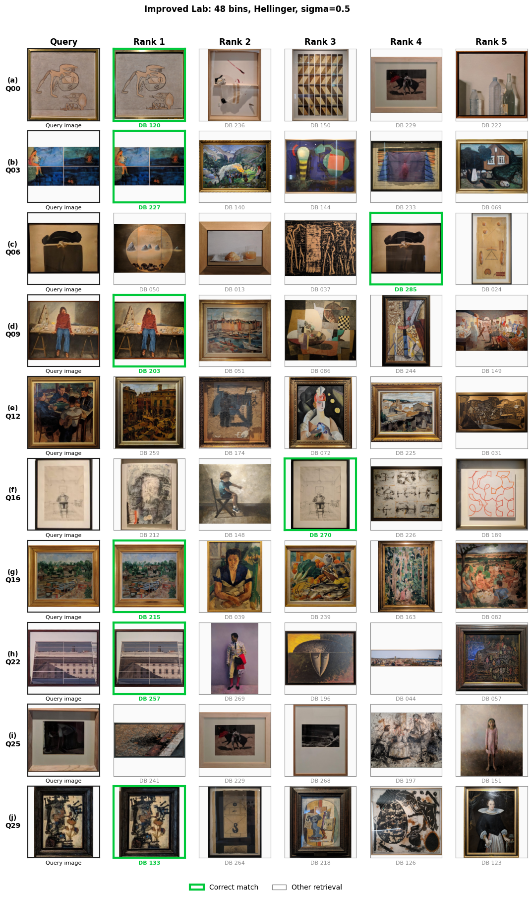

# C1 Museum Painting Retrieval

Content-based image retrieval for the museum-painting dataset. The project currently covers Week 1 and Week 2: global colour histograms, spatial descriptors, background removal, masked retrieval, evaluation, and submission generation.

## Team 3

- Eduard Barnadas Conangla
- Paula Gálvez Serrano
- Femiloye Oluseun Oyerinde
- Ares Sellart Sánchez

## Project structure

Reusable code is kept at repository level so later weeks can build on the same implementation. Week folders contain only week-specific notebooks, reports, and assets.

```text
data/                         local datasets (not tracked by Git)
src/                          shared retrieval package
  color_histogram_retrieval.py
  data.py                     deterministic image and mask loading
  distances.py                vectorised distance measures
  evaluation.py               retrieval and segmentation metrics
  methods.py                  selected method configurations
  retrieval.py                feature ranking
  segmentation.py             colour-based background removal
  spatial_histograms.py       spatial and masked Lab descriptors
  submission.py               submission writing and validation
scripts/
  week1/                      Week 1 evaluation and generation commands
  week2/                      Week 2 evaluation and generation commands
submissions/Team3/
  week1/                      Week 1 deliverables
  week2/                      Week 2 deliverables
week1/assets/                 Week 1 figures
week2/cropped_histograms.ipynb
```

The Week 2 notebook remains self-contained and unchanged. The reusable implementations extracted from the experiments live in `src/`; the command-line workflows use those shared modules.

## Setup

Python 3.10 or newer is recommended. From the repository root, install the dependencies with:

```bash
python -m pip install -r requirements.txt
```

The default commands expect these datasets:

```text
data/BBDD/                    museum database
data/qsd1_w1/                Week 1 development queries and ground truth
data/qst1_w1/                Week 1 blind-test queries
data/qsd2_w1/                Week 2 queries, masks, and correspondences
data/qst_w2/qst1_w2/         Week 2 test images without background noise
data/qst_w2/qst2_w2/         Week 2 test images requiring segmentation
```

## Week 1 — Global colour histograms

Week 1 established the retrieval baseline. Each image is converted to a selected colour space, represented by one normalised histogram per channel, and compared with the database using a histogram distance.

The experiments covered grayscale, individual RGB channels, concatenated colour spaces, histogram sizes, Gaussian smoothing, distance functions, and Lab channel weights.

| Method | Configuration | mAP@1 | mAP@5 | Hit Rate@5 |
|---|---|---:|---:|---:|
| Individual RGB-G baseline | 16 bins, σ=0.5, Hellinger | 0.333 | 0.357 | 0.400 |
| Team HSV selection | 32 bins, σ=1.0, L1, equal weights | 0.500 | 0.596 | 0.767 |
| Team Lab selection | 64 bins, no smoothing, L1, equal weights | 0.533 | 0.599 | 0.733 |
| Team HSV best observed | 16 bins, σ=0.5, L1, equal weights | 0.567 | 0.629 | 0.767 |
| Improved Lab — simple | 40 bins, no smoothing, L1, equal weights | 0.633 | 0.662 | 0.733 |
| **Improved Lab — tuned** | **48 bins, σ=0.5, Hellinger, weights 0.125/0.5/0.375** | **0.700** | **0.728** | **0.800** |

The tuned Lab descriptor performed best. Downweighting lightness and emphasizing the chromatic axes reduced sensitivity to illumination changes.



### Week 1 submission methods

| Submission folder | Method |
|---|---|
| `method1` | HSV, 16 bins, σ=0.5, L1, equal channel weights |
| `method2` | Lab, 48 bins, σ=0.5, Hellinger, weights 0.125/0.5/0.375 |

Evaluate the development set and regenerate the QST1 results with:

```bash
python scripts/week1/evaluate_week1.py
python scripts/week1/generate_qst1.py
```

The generated CSV and manifest are stored under `outputs/week1/`. Use `--help` on either script to see the available path and retrieval-depth options.

## Week 2 — Spatial histograms and background removal

Week 2 extends the colour-histogram pipeline with spatial information and foreground segmentation.

### Tasks

1. **Spatial descriptors:** divide each image into blocks and concatenate the per-block Lab histograms.
2. **Descriptor evaluation:** compare spatial configurations on QSD1 and select the best method using mAP@1 and mAP@5.
3. **Background removal:** estimate the painting foreground from border colours and produce a binary mask.
4. **Mask evaluation:** compare predicted QSD2 masks with the annotations using precision, recall, and F1.
5. **Masked retrieval:** apply the selected Task 2 descriptor only to predicted foreground pixels and return painting correspondences.
6. **Submission generation:** produce top-10 QST1/QST2 rankings and one binary PNG mask per QST2 image.

The selected Week 2 descriptor is a `5 × 5` spatial Lab histogram with 48 bins per channel, σ=0.5 smoothing, channel weights `0.125/0.5/0.375`, and Hellinger ranking. For QSD2 and QST2, the image is cropped to the predicted foreground bounds and histogram bins are populated only by foreground pixels.

### Current Week 2 results

| Evaluation | Metric | Score |
|---|---|---:|
| Task 2 — QSD1 retrieval | mAP@1 | 0.867 |
| Task 2 — QSD1 retrieval | mAP@5 | 0.892 |
| Task 4 — mask quality, macro | Precision / Recall / F1 | 0.955 / 0.978 / 0.965 |
| Task 4 — mask quality, micro | Precision / Recall / F1 | 0.979 / 0.989 / 0.984 |
| Task 5 — QSD2 masked retrieval | mAP@1 | 0.700 |
| Task 5 — QSD2 masked retrieval | mAP@5 | 0.768 |

The experiment narrative, visualisations, and cell-by-cell work are in [`week2/cropped_histograms.ipynb`](week2/cropped_histograms.ipynb).

Evaluate Tasks 2, 4, and 5 with:

```bash
python scripts/week2/evaluate_week2.py
```

This writes the machine-readable summary to `outputs/week2/evaluation.json` by default.

The evaluator keeps the selected 5x5, 1D descriptor by default. Pyramid and joint
Lab representations can be evaluated without changing the source configuration:

```bash
python scripts/week2/evaluate_week2.py --levels 1 2 4 --pyramid-weights
python scripts/week2/evaluate_week2.py --levels 1 2 4 --hist-type 2d --pyramid-weights
python scripts/week2/evaluate_week2.py --levels 1 2 --hist-type 3d --level-weights 0.4 0.6
```

`1d` represents independent L, a, and b histograms, `2d` represents a joint a-b
histogram, and `3d` represents a joint L-a-b histogram. The 2D and 3D options
should use fewer bins because their feature vectors grow quadratically or
cubically with the bin count. The same representation and level weights are
used for complete and masked retrieval, and the selected method is recorded in
the evaluation JSON.

Generate and validate the Week 2 submission with:

```bash
python scripts/week2/generate_submissions.py
```

The resulting structure is:

```text
submissions/Team3/week2/
  QST1/method1/result.pkl
  QST2/method1/result.pkl
  QST2/method1/00000.png
  QST2/method1/...
  QST2/method1/00029.png
```

Each pickle contains one ordered top-10 database-ID list per query. The QST2 method folder also contains a correctly named binary mask for every query image.

## Metrics

- **mAP@1:** top-1 retrieval accuracy when each query has one relevant painting.
- **mAP@5:** rewards retrieving the relevant painting closer to the first position within the top five.
- **Hit Rate@5:** fraction of queries whose relevant painting appears anywhere in the top five.
- **Precision, recall, and F1:** pixel-level foreground-mask quality measures used in Task 4.

## Reproducibility

- Dataset files are loaded in numeric filename order.
- Retrieval outputs contain plain Python integer IDs.
- Submission scripts validate row counts, ranking length, database IDs, mask names, dimensions, and binary values before completing.
- Method configurations are defined centrally in `src/methods.py`.
